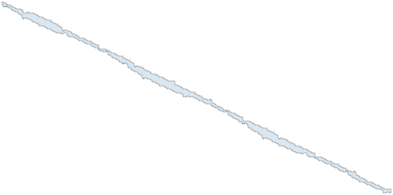

# A polyomino that folds into five different boxes

One connected, hole-free shape made of **2,128 unit squares** that folds, along grid lines only, onto the surfaces of
**five different rectangular boxes**:

| Box | Surface area | Volume |
|---|---:|---:|
| 2 × 4 × 176 | 2,128 | 1,408 |
| 4 × 8 × 86 | 2,128 | 2,752 |
| 4 × 14 × 56 | 2,128 | 3,136 |
| 4 × 16 × 50 | 2,128 | 3,200 |
| 4 × 26 × 32 | 2,128 | 3,328 |



**Interactive 3-D viewer** (folds the net into each box, one fold line at a time): [`viewer/index.html`](viewer/index.html)
(open it locally, or online at https://sprite143.github.io/five-box-net-2128/viewer/ once GitHub Pages is enabled).

## Why this matters

Whether one polyomino can fold into four different boxes with grid-line folds was open from 2012 (Shirakawa and
Uehara) until October 2026, when the 532-square four-box net was posted
([Sprite143/four-box-net-532](https://github.com/Sprite143/four-box-net-532)); before that, the most boxes known from
one polyomino was three (Demaine, Diomidova, Jacobus, Kryger, Parker, Tardibuono, Uehara and Zhang, CCCG 2026,
[arXiv:2608.19910](https://arxiv.org/abs/2608.19910)). This net folds into **five**.

At half scale its boxes are 1 × 2 × 88, 2 × 4 × 43, 2 × 7 × 28, **2 × 8 × 25** and 2 × 13 × 16: the four boxes of the
532-square net plus a fifth. The construction behind the 532-square net cannot reach that fifth box, because each edge
of its strip can carry at most two "zip" gluings. This net works at twice the scale, where the boundary has room for
finer detail, and its folds close up along branched gluing trees instead of zips (see the verification notes).

**Status: not yet peer reviewed.** We believe the net is correct (see the checks below). Corrections are very
welcome; please open an issue.

## Check it yourself

```bash
python verify_folds.py
```

Standard-library Python only. It reads `data/cells.txt`, checks the shape (connected, no holes, no squares touching
only at a corner), and tests **every** integer box with surface area 2,128 (there are 28). Expected output: the five
boxes above fold; the other 23 do not. It also writes `folds.json` (which face each square lands on), used by the
simulation below. Runs in about 15 minutes.

"Folds" means: every square of the net lands on exactly one unit square of the box surface (so the surface is covered
exactly once, with no overlap), every pair of squares that share an edge in the flat net stay joined along that edge on
the box, and all folds are along grid lines. All arithmetic is exact (integers).

```bash
python simulate_folding.py          # needs numpy and scipy; run verify_folds.py first
```

Folds each box as a rigid object, one fold line at a time from square (57, −30) at one end of the strip, testing every
position for two squares passing through each other. Result: **no collisions** for any of the five boxes (80, 73, 43, 53 and 42 fold lines;
7,200, 6,570, 3,870, 4,770 and 3,780 positions checked at 1° steps for 2×4×176, 4×8×86, 4×14×56, 4×16×50 and
4×26×32; also none at 0.5° steps). Starting from the middle of the strip instead does collide, so the order matters
and the test detects collisions.

**The paper authors' own checker** also confirms all five boxes: `authors-checker/CheckNet.java` is a small driver for
`OutputReader.ValidNetSolutionChecker.hasSolution` from
[hidny/CuboidSimplePhaseNetSearch](https://github.com/hidny/CuboidSimplePhaseNetSearch). Compile it against that
repository's `src` folder:

```bash
javac -d classes -sourcepath CuboidSimplePhaseNetSearch/src CheckNet.java
java -cp classes CheckNet data/cells.txt 2,4,176 4,8,86 4,14,56 4,16,50 4,26,32
```

Full details, including the controls: [`docs/five-box-net-verification.md`](docs/five-box-net-verification.md).

## How it was found

**Conner Silverstein** and **Reed Silverstein**, building on their 532-square four-box net. The net was found with an
AI model (ChatGPT, OpenAI); the independent verification above was carried out with Claude (Anthropic). AI systems did
most of the construction and checking; we say so up front.

In short: a search first produced a 530-square partial shape fitting parts of all five (half-scale) box surfaces, but
it had no completion. Doubling it (each square becomes a 2 × 2 block) gave a 2,120-square partial shape for the
doubled boxes, and a search on the finer grid then repaired its boundary (keeping 1,840 of those squares, removing
280 and adding 288) to reach the complete 2,128-square net. The original write-up:
[`docs/fivebox-2128-original-writeup.md`](docs/fivebox-2128-original-writeup.md).

## Files

| Path | Contents |
|---|---|
| `data/cells.txt` | The 2,128 squares as `x,y;x,y;...` (square `(x, y)` spans `[x, x+1] × [y, y+1]`) |
| `data/five-box-net-outline.svg` | The cut outline on the unit grid (prints at 5 mm per square) |
| `verify_folds.py` | Standalone fold checker |
| `simulate_folding.py` | Rigid folding, one fold line at a time, with collision tests |
| `authors-checker/CheckNet.java` | Driver for the area-106 authors' checker |
| `viewer/index.html` | 3-D folding viewer |
| `docs/` | Verification notes and the original write-up |

## Folding it from paper

The net spans 389 × 191 squares (at 5 mm per square, about 1.95 × 0.96 m). Score every grid line inside the outline;
for each box, fold only that box's creases, starting from the end of the strip at square (57, −30).

## License

Code (`*.py`, `*.java`): MIT. Data, figures and write-ups: CC BY 4.0. See [`LICENSE`](LICENSE).

## Citing

Conner Silverstein and Reed Silverstein, *A polyomino that folds into five different boxes*, 2026,
https://github.com/Sprite143/five-box-net-2128
